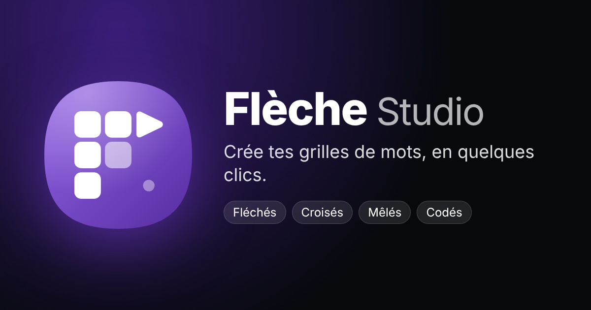

# Flèche Studio



Créateur de grilles de **mots fléchés, croisés, mêlés et codés**, 100 % dans le navigateur :
tes mots, tes définitions, ton style. Export PNG, JPEG, WebP, SVG, PDF ou ZIP, lien de partage
pour jouer en ligne, application installable qui fonctionne hors connexion. Interface en
français et en anglais.

**Aucun serveur, aucun compte** : les grilles restent dans le navigateur (localStorage et
IndexedDB). Les seules requêtes externes vont au Wiktionnaire et à Wikipédia (définitions,
listes de mots par thème), sans cookie ni référent.

## Fonctionnalités

- **5 jeux** : mots fléchés, mots croisés, mots mêlés, mots codés (une ou deux grilles par projet),
  et **Murdoku** : une enquête logique sur un plan en diorama 3D peint (rendu adapté de
  [building-builder](https://github.com/corentin-ne/building-builder), sources dans `src3d/`,
  `npm run build:3d` produit `js/vendor/murdoku3d.js`), avec un plan 2D de secours.
  17 univers (manoir, sirènes, samouraïs, Paris, bal de la Régence, pharaons, pirates, Far West,
  station spatiale, château hanté…) avec leurs lieux, objets, suspects et histoire, tous
  modifiables ; 4 niveaux, de Facile à Expert.
- **Studio et jeu séparés** : le studio crée (solution ou grille vierge) ; on joue sur une page à
  part, depuis la Salle de jeu du tableau de bord.
- **Mots** : saisie avec autocomplétion et correction, dictionnaire intégré (FR, EN),
  18 packs à thème de 25 mots définis, catégories du Wiktionnaire, tirage au hasard,
  import texte, CSV, JSON ou Excel.
- **Définitions** : dictionnaire local, Wiktionnaire, Wikipédia et Wikidata.
- **Multicolore** : lettres, cases, définitions et mots en plusieurs couleurs (palettes ou couleurs au choix).
- **Design** : thèmes, formes (cœur, étoile, lettres…), polices, fonds, stickers, photos,
  formats de page (A4, carré, story…).
- **Jeu** : mode jeu avec chronomètre, indices, vérification et meilleur temps ; lien de
  partage et QR code (la grille est dans le lien).
- **Export** : fichiers à la résolution voulue, impression ou PDF, lot ZIP ou PDF de toutes
  les grilles avec leurs solutions.
- **Sécurité des données** : sauvegarde complète en un fichier, rappel de sauvegarde,
  versions automatiques, stockage durable demandé au navigateur.

## Lancer en local

Aucune étape de construction : ce sont des fichiers statiques.

```sh
npm run serve        # http://localhost:5180 (Python requis)
```

Ouvrir directement `index.html` fonctionne aussi, sans service worker.

## Vérifier

```sh
npm ci
npx playwright install chromium   # une seule fois
npm run check        # lint + types + tests
```

`npm test` lance, dans Chromium :

1. un budget de poids des fichiers envoyés au navigateur ;
2. les tests du moteur (`tests/index.html`, aussi consultable dans le navigateur) ;
3. l'application en français et en anglais (création, calcul, mode jeu) ;
4. les parcours principaux : packs à thème, annuler / rétablir, export PNG, sauvegarde puis
   restauration, lien de partage, accessibilité (axe) ;
5. l'affichage sur téléphone.

Pour utiliser un navigateur déjà installé : `PW_CHANNEL=chrome` (ou `msedge`), ou
`PW_EXECUTABLE=/chemin/vers/chromium`.

## Organisation

| Dossier | Contenu |
| --- | --- |
| `js/core` | état (store), schéma de validation, stockage, partage, traductions |
| `js/engine` | moteurs de grilles (exécutés dans un Web Worker), rendu SVG / canvas |
| `js/ui`, `js/app` | interface, panneaux, export, mode jeu |
| `js/data` | dictionnaires, packs à thème, thèmes, palettes, stickers |
| `js/services` | dictionnaire local, Wiktionnaire / Wikipédia, imports |
| `js/loader.js` | liste unique des fichiers, dans l'ordre de chargement |
| `css`, `fonts` | styles et polices hébergées avec l'application |
| `icons` | icônes PNG et image d'aperçu, générées par `npm run images` depuis `icon.svg` |
| `tests` | tests du moteur (navigateur) et `ci.mjs` (Playwright) |

## Déploiement

Chaque push sur `main` passe par `.github/workflows/pages.yml` : vérifications, puis
publication sur GitHub Pages d'une liste blanche de fichiers. La version de déploiement
(empreinte du commit) est inscrite dans les fichiers pour renouveler les caches, et l'adresse
du site dans les balises d'aperçu des liens.

## Licences

Code : tous droits réservés. Polices : SIL Open Font License 1.1 (Permanent Marker : Apache
License 2.0), voir `fonts/LICENSES.txt`. Définitions en ligne : Wiktionnaire et Wikipédia
(CC BY-SA).
