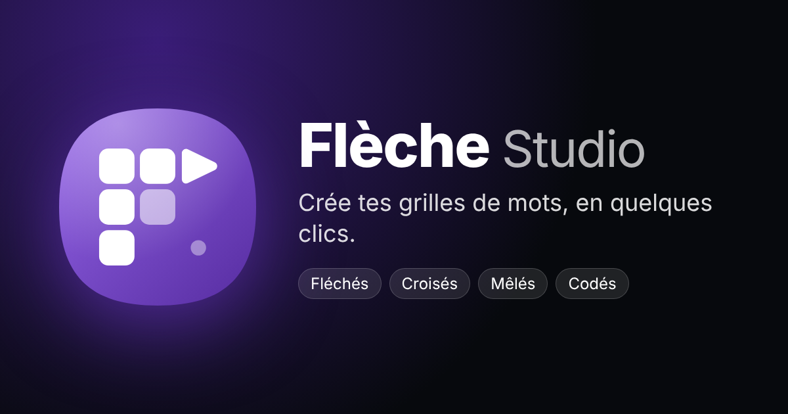

# Flèche Studio



Créateur de grilles de **mots fléchés, croisés, mêlés, codés, sudoku, picross, logigrammes, gratte-ciel,
binairo, coloriage magique, 7 différences** et bien d'autres (35 jeux), 100 % dans le navigateur :
tes mots, tes définitions, ton style. Export PNG, JPEG, WebP, SVG, PDF ou ZIP, lien de partage
pour jouer en ligne, application installable qui fonctionne hors connexion. Interface en
français et en anglais.

**Aucun serveur, aucun compte** : les grilles restent dans le navigateur (localStorage et
IndexedDB). Les seules requêtes externes vont au Wiktionnaire et à Wikipédia (définitions,
listes de mots par thème), sans cookie ni référent.

## Fonctionnalités

- **35 jeux**, en quatre familles :
  - **lettres** : mots fléchés, mots croisés, mots casés, mots codés, mots mêlés, mot mystère (une ou deux
    grilles par projet), citation codée, échelle de mots, wordoku, mots en escalier, acrostiche, anagrammes ;
  - **chiffres** : sudoku (classique, irrégulier, X ; 4×4 à 9×9), kakuro, nombres fléchés et croisés
    (définitions calculées), calcudoku, futoshiki, gratte-ciel, binairo, suguru, numbrix / hidato ;
  - **logique & enquêtes** : logigramme (suspects, lieux, objets et heures des univers du Murdoku), Murdoku,
    étoiles, lumières (akari), tentes et arbres, bataille navale, hitori, boucle (slitherlink), labyrinthe
    (carré ou dans une forme) ;
  - **dessins à découvrir** : picross, mosaïque, coloriage magique et points à relier (dessin tiré d'un
    emoji, d'une forme, d'un texte ou d'une photo, sans service extérieur), 7 différences (deux plateaux 3D d'un
    univers du Murdoku, décor de plus en plus chargé selon le niveau ; différences repérées en comparant les
    deux images, `js/ui/diff3d.js` ; plan 2D sans WebGL).
  Les jeux de chiffres et de logique (`js/engine/logic*.js`) sont créés par un solveur de contraintes
  qui garantit **une seule solution** ; ils ont tout le reste en commun avec les grilles de mots
  (thèmes, multicolore, décor, export, lien de partage, mode jeu chronométré). Les jeux de la version 6
  s'inscrivent dans un registre (`MF.logicGames`, `js/engine/logic-grids.js`) : chacun y décrit son
  générateur, la vérification de ses pages et son dessin, sans test sur son identifiant ailleurs.
- **Choix des jeux** : recherche, filtres par famille, pastille « Nouveau », « Surprends-moi » dans la
  salle de jeu ; en partie, le geste de jeu propre à chaque jeu et un bouton « Règles ».
- **Murdoku** : une enquête logique sur un plan en diorama 3D peint (rendu adapté de
  [building-builder](https://github.com/corentin-ne/building-builder), sources dans `src3d/`,
  `npm run build:3d` produit `js/vendor/murdoku3d.js`), avec un plan 2D de secours.
  25 univers (manoir, sirènes, samouraïs, Paris, bal de la Régence, pharaons, pirates, Far West,
  station spatiale, château hanté, forêt enchantée, Noël, anniversaire, Saint-Valentin, Halloween, Pâques, carnaval,
  Nouvel an chinois…) avec leurs lieux, objets, suspects et histoire, tous modifiables ; 4 niveaux, de Facile à
  Expert. Caméra libre sur le plateau 3D : tourner, incliner, zoomer, déplacer. Chaque univers a ses
  meubles 3D (futon, hamac, trône, brasero…) et ses personnages en costume (`src3d/kit/`, `src3d/outfits.js`).
- **Bibliothèque de thèmes** commune à tous les jeux (`js/data/library.js`) : un seul ordre, rangé en rayons
  (Styles, Univers, Fêtes). Un thème a sa version 2D (grilles), 3D (univers Murdoku) ou les deux ; les styles
  simples restent en 2D. Réorganiser = déplacer un identifiant dans la liste des rayons.
- **Deux espaces, Créer et Jouer** (barre du haut) : Créer = « Mes créations » et le studio
  (solution ou grille vierge) ; Jouer = la salle de jeu (`js/ui/arcade.js`) : une nouvelle partie
  en deux réglages au plus, dont la grille se construit sans montrer la solution, et toutes ses
  grilles à jouer (nouvelle, en cours, record). En partie, « Éditer » ouvre la grille dans le studio.
  En création, toutes les grilles (mots, chiffres, logique) se remplissent en direct, sauf le
  diorama 3D du Murdoku.
- **Mots** : saisie avec autocomplétion et correction, dictionnaire intégré (FR, EN),
  18 packs à thème de 25 mots définis, catégories du Wiktionnaire, tirage au hasard,
  import texte, CSV, JSON ou Excel.
- **Définitions** : dictionnaire local, Wiktionnaire, Wikipédia et Wikidata.
- **Multicolore** : lettres, cases, définitions et mots en plusieurs couleurs (palettes ou couleurs au choix).
- **Effet impression art-book** : trame de points, couleurs légèrement décalées, papier et grain,
  comme les plateaux Murdoku en 3D ; les textes restent nets, à l'écran comme dans les exports.
- **Design** : thèmes, formes (cœur, étoile, lettres…), polices, fonds, stickers, photos,
  formats de page (A4, carré, story…).
- **Jeu** : mode jeu avec chronomètre, indices, vérification et meilleur temps ; lien de
  partage et QR code (la grille est dans le lien).
- **Export** : fichiers à la résolution voulue, impression ou PDF, lot ZIP ou PDF de toutes
  les grilles avec leurs solutions.
- **Sécurité des données** : sauvegarde complète en un fichier, rappel de sauvegarde,
  versions automatiques, stockage durable demandé au navigateur.

## Lancer en local

Aucune étape de construction : ce sont des fichiers statiques.

```sh
npm run serve        # http://localhost:5180 (Python requis)
```

Ouvrir directement `index.html` fonctionne aussi, sans service worker.

## Vérifier

```sh
npm ci
npx playwright install chromium   # une seule fois
npm run check        # lint + types + tests
```

`npm test` lance, dans Chromium :

1. un budget de poids des fichiers envoyés au navigateur ;
2. les tests du moteur (`tests/index.html`, aussi consultable dans le navigateur) ;
3. l'application en français et en anglais (création, calcul, mode jeu) ;
4. les parcours principaux : packs à thème, annuler / rétablir, export PNG, sauvegarde puis
   restauration, lien de partage, accessibilité (axe) ;
5. l'affichage sur téléphone.

Pour utiliser un navigateur déjà installé : `PW_CHANNEL=chrome` (ou `msedge`), ou
`PW_EXECUTABLE=/chemin/vers/chromium`.

## Organisation

| Dossier | Contenu |
| --- | --- |
| `js/core` | état (store), schéma de validation, stockage, partage, traductions |
| `js/engine` | moteurs de grilles (exécutés dans un Web Worker), rendu SVG / canvas |
| `js/ui`, `js/app` | interface, panneaux, export, mode jeu |
| `js/data` | dictionnaires, packs à thème, thèmes, palettes, stickers |
| `js/services` | dictionnaire local, Wiktionnaire / Wikipédia, imports |
| `js/loader.js` | liste unique des fichiers, dans l'ordre de chargement |
| `css`, `fonts` | styles et polices hébergées avec l'application |
| `icons` | icônes PNG et image d'aperçu, générées par `npm run images` depuis `icon.svg` |
| `tests` | tests du moteur (navigateur) et `ci.mjs` (Playwright) |

## Déploiement

Chaque push sur `main` passe par `.github/workflows/pages.yml` : vérifications, puis
publication sur GitHub Pages d'une liste blanche de fichiers. La version de déploiement
(empreinte du commit) est inscrite dans les fichiers pour renouveler les caches, et l'adresse
du site dans les balises d'aperçu des liens.

## Licences

Code : tous droits réservés. Polices : SIL Open Font License 1.1 (Permanent Marker : Apache
License 2.0), voir `fonts/LICENSES.txt`. Définitions en ligne : Wiktionnaire et Wikipédia
(CC BY-SA).
